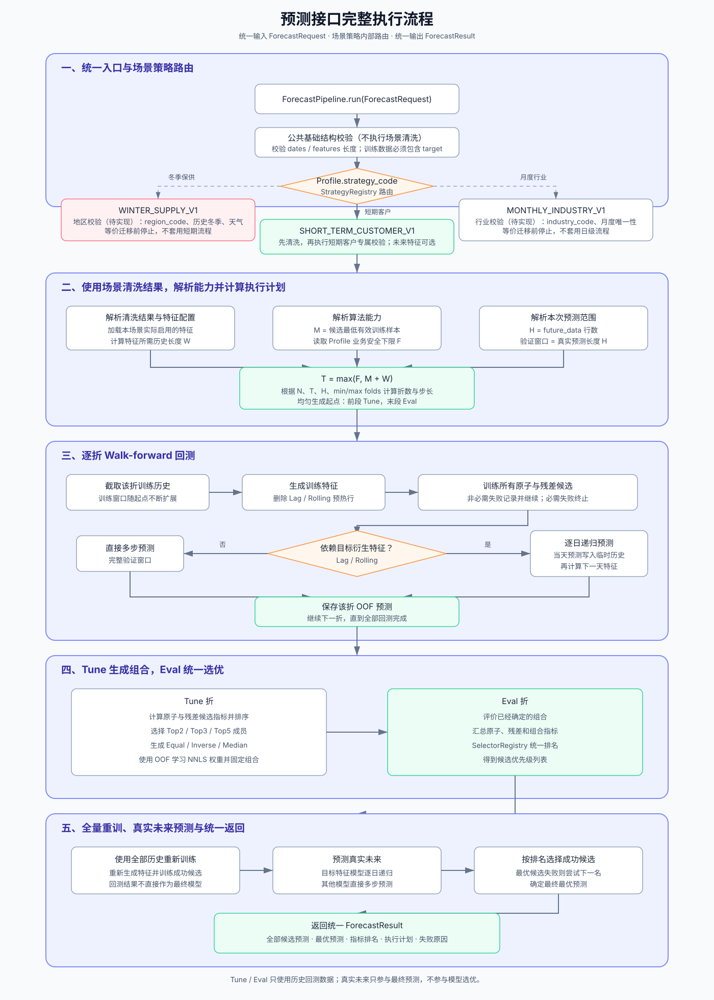

# Gas Model Engine

`gas-model-engine` 是一个与城市、行业和接口协议解耦的预测模型底座。它负责把一次预测任务确定性地组织为：

```text
输入历史与未来数据
  → 解析预测方案 Profile
  → 解析特征配置，计算特征所需历史长度
  → 计算执行计划
  → 按每个 Walk-forward 窗口生成特征
  → 回测原子与残差模型
  → 生成合法的结果组合
  → Tune / Eval 选优
  → 使用全量历史重新训练
  → 预测未来并返回全部候选与最优结果
```

城市、行业、客户、天气和业务动态字段都是本次调用的数据或 Profile 参数，不应复制一套算法代码。只有计算方法或完整预测流程确实不同时，才新增算法、方法或 Profile。

## 1. 对外入口与内部边界

上层业务只使用 `ForecastPipeline`：

```python
from gas_model_engine import ForecastRequest, create_default_forecast_pipeline

pipeline = create_default_forecast_pipeline()
result = pipeline.run(
    ForecastRequest(
        profile_code="short-term",
        train_data=history,
        future_data=future,
    )
)
```

- `ForecastPipeline`：业务统一入口；解析 Profile 和执行策略，返回完整预测结果。
- `AlgorithmEngine`：Pipeline 内部的单算法执行器；完成算法查找、参数校验、输入校验、训练和预测，不作为业务预测入口。
- `AlgorithmProfile`：声明一个场景允许使用哪些特征、算法、回测、组合及选优方法。
- Registry：根据稳定编码查找方法实现，避免在流程中编写大量 `if/else`。

可以把它们理解为：

```text
ForecastPipeline             一次完整预测任务
└── ForecastStrategy         任务的流程编排方式
    ├── Profile              本场景允许使用的配置
    ├── FeatureRegistry      特征怎么算
    ├── BacktestRegistry     回测计划怎么算
    ├── AlgorithmEngine      单个模型怎么训练和预测
    ├── CombinationRegistry  回测结果怎么组合
    └── SelectorRegistry     最终候选怎么排名
```

## 2. 包结构及职责

```text
src/gas_model_engine/
├── algorithms/       算法定义、统一契约、注册中心和具体算法
├── features/         特征方法及特征生成流程
├── backtesting/      Walk-forward 回测计划
├── combinations/     根据 OOF 结果创建结果组合候选
├── selection/        原子、残差和组合候选的统一排名
├── benchmarking/     旧代码与新 Pipeline 的离线迁移验收
├── profiles/         场景可用算法范围与方法配置
├── execution/        完整预测流程的编排与统一输入输出契约
├── engine.py         内部单算法执行器 AlgorithmEngine
└── methods.py        通用方法元数据和注册中心基类
```

### `benchmarking/`

该包是迁移期间保留的离线验收工具，不进入线上预测主链路。调用方分别提供
旧代码和新 Pipeline 的适配函数，工具保证在同一组日期、真实值和回测折上计算：

- MAPE、RMSE、MAE、WMAPE；
- 每折误差以及每折 MAPE 标准差；
- 基于本地节假日日历识别的春节误差；
- 两套实现各自的执行时间。

```python
from gas_model_engine import BenchmarkDataset, ForecastBenchmark, render_markdown

dataset = BenchmarkDataset(
    dates=validation_dates,
    actual=validation_actual,
    fold_ids=validation_fold_ids,
    payload=shared_input,
)
report = ForecastBenchmark().compare(
    dataset,
    old_predictor=lambda data: run_legacy_code(data),
    new_predictor=lambda data: run_new_pipeline(data),
)
markdown = render_markdown(report)
```

旧工程返回DataFrame、字典或其他对象时使用 `LegacyForecastAdapter` 提取预测列；
新工程使用 `PipelineForecastAdapter` 从共享输入构造 `ForecastRequest` 并自动提取
`final_prediction.values`。适配器不复制业务算法，只隔离两套工程不同的调用协议。

适配函数只能返回对应日期的一维预测结果；`actual` 仅交给评估器，不能放入模型
训练输入。春节日期不在本地日历覆盖范围或本次样本没有春节时，报告明确显示
“无样本”，不会用总体误差代替。生产切换完成后可以继续保留该工具做版本回归。

### `algorithms/`

存放“算法本身”，一个算法一个文件，并按算法类型分簇：

```text
algorithms/
├── baseline/     朴素值、移动平均、EWMA 等基线算法
├── statistical/  ARIMA、Prophet、SARIMAX、Theta 等统计时序算法
├── linear/       Ridge、Lasso、Huber 等线性回归算法
├── tree/         LightGBM、XGBoost、随机森林等树模型
└── composite/    残差修正、加权、Stacking 等算法级组合
```

所有算法继承 `BaseAlgorithm`，统一暴露：

- `fit`：训练并返回 `AlgorithmModel`。
- `predict`：使用模型预测并返回 `PredictionResult`。
- `save` / `load`：保存和加载模型。
- `get_default_params`：返回默认参数。
- `validate_params`：校验并规范算法参数。
- `validate_input`：校验训练或预测数据。
- `get_capabilities`：声明最少训练样本、是否支持特征、区间预测等能力。
- `dependencies`：组合算法声明其依赖的成员算法。

`AlgorithmDataset` 是统一的数据契约，包含：

- `features`：二维特征表。
- `dates`：与特征逐行对应的日期。
- `target`：训练期真实目标；未来预测数据可为空。
- `sample_weight`：可选样本权重。
- `metadata`：流程内部附加信息。

### `features/`

特征包负责“特征怎么算”，不负责决定模型、回测或最终选优。

当前内置方法：

- `DYNAMIC_PASSTHROUGH_V1`：透传调用方在历史和未来都提供的数值字段，如天气和动态业务量。
- `CALENDAR_V1`：生成年、月、日、星期和周末特征。
- `LAG_V1`：生成目标值的历史滞后特征，如 `lag_1`、`lag_7`。
- `ROLLING_V1`：生成目标历史窗口的均值、标准差、最小值和最大值。

训练阶段，历史真实值完整存在，可以批量计算 Lag/Rolling。开头历史不足的预热行会被删除，不使用未来值向前填充。

预测未来多天时，目标衍生特征按天递归计算：

```text
已有真实历史
  → 计算未来第1天特征
  → 预测第1天
  → 将第1天预测加入临时历史
  → 计算未来第2天特征
  → ……
```

回测也使用同一套递归过程。验证期的真实值只用于评分，不能参与后续日期的 Lag/Rolling 计算，否则会发生数据泄漏。

不依赖目标衍生特征的模型仍可直接执行多步预测。

#### 特征目录与三套智能体配置

所有特征统一登记在 `src/gas_model_engine/config/features/catalog.yaml`。目录中的每项都包含稳定编码、中文名称、中文说明、类别、实现方法、启用状态和默认必需性。`enabled: false` 表示特征已经规划但计算实现尚未接入，运行时不会误用。

三个预测智能体分别使用一套 Feature Policy：

```text
config/features/
├── catalog.yaml
└── policies/
    ├── winter-supply.yaml       冬季保供，按地区预测
    ├── short-term-customer.yaml 短期客户，按客户预测
    └── monthly-industry.yaml    月度预测，按行业预测
```

对应关系：

```text
winter-supply
→ WINTER_SUPPLY_FEATURES_V1
→ metadata.region_code 必需

short-term
→ SHORT_TERM_CUSTOMER_FEATURES_V1
→ metadata.industry_name 必需，用于匹配行业配置
→ 不要求模型引擎识别customer_code

monthly-industry
→ MONTHLY_INDUSTRY_FEATURES_V1
→ metadata.industry_code 必需
```

`FeaturePolicyResolver` 会读取目录和 Policy，匹配本次上下文及历史/未来共有字段，生成实际 `MethodSpec`。必需特征缺失会终止任务；可选特征缺失会跳过并记录原因。最终使用和跳过的特征会写入回测结果的 `feature_plan` 元数据。

Profile 只引用 Policy 编码，不复制全量特征定义：

```python
AlgorithmProfile(
    code="short-term",
    strategy_code="SHORT_TERM_CUSTOMER_V1",
    feature_policy_code="SHORT_TERM_CUSTOMER_FEATURES_V1",
    ...,
)
```

### `backtesting/`

回测包只负责生成历史模拟预测计划，不负责训练具体算法。

当前 `EXPANDING_WALK_FORWARD_V1` 使用扩展训练窗口：每一折都使用预测起点之前的全部可用历史，再模拟一次完整的未来预测任务。

执行计划中的关键量：

```text
N = 历史数据条数
H = 本次未来预测条数
W = max(最大 Lag, 最大 Rolling 窗口)
M = 所有候选算法声明的最低有效训练样本数
F = Profile 声明的业务安全下限

最小原始训练长度 T = max(F, M + W)
验证窗口             = H
可用起点范围         = N - T - H
实际回测次数         = min(max_folds, 可用的不同起点数)
回测步长             = 可用起点范围 / (实际回测次数 - 1)
```

最后一折始终预测历史末端之前的完整区间，其余起点尽量均匀覆盖可用历史。步长与接口多久调用一次无关，也不再简单固定为预测长度。

`short-term` 当前配置为：

- 业务安全下限 `minimum_train_floor=90`。
- 至少3折，最多5折。
- 最后2折用于 Eval，其余折用于 Tune。

Prophet 残差组合还会在每个训练区间内部执行一次公共的 Walk-forward OOF
残差构造：每一段 Prophet 预测都只使用该段日期之前的历史训练，再以
`真实值 - OOF预测` 训练 AR、XGBoost 或 LightGBM。短期 Profile 当前显式配置
内部3折、最小基础训练长度30条；这是计算预算参数，不是写死在组合算法中的
业务规则。最终预测时，Prophet 使用全量历史重训，残差成员使用汇总后的 OOF
残差训练，从而避免学习 Prophet 对训练集的拟合误差。

残差组合默认还会从上述 OOF 真实残差分布学习预测修正边界，当前短期 Profile
使用1%和99%分位数。未来残差模型给出的修正量超出历史可信范围时只裁剪修正量，
不裁剪 Prophet 基础预测。该规则通过 `residual_clip` 配置，可以按场景调整或关闭，
无需在算法代码中写死某个客户的销量上下限。

所有候选最终还会使用 Eval 样本外绝对误差统一校准预测区间。短期 Profile 当前
配置覆盖率为80%；不支持原生区间的算法也会返回上下界，支持原生区间的算法则
改用相同的 Eval 校准口径，便于候选间公平比较。区间表达历史回测误差范围，
不是销量一定落入其中的业务承诺。

XGBoost和LightGBM残差成员支持时间有序早停：只从当前训练区间末段留出内部验证集，
不随机打乱，也不会读取外层Eval折。短期 Profile 当前留出20%、至少10条，连续30轮
无改善后停止；最终模型会记录 `best_iteration`。早停预算同样属于Profile参数。

V2/V3残差成员还会使用同一折Prophet产生的样本外组件特征：`prophet_yhat`、趋势、
周周期、年周期以及加法/乘法项。未来预测时从最终Prophet生成同名组件，因此训练
与预测字段一致。天气和日历继续由公共特征层提供，不在组合算法中重复实现。

V2/V3还会使用销量滞后1/7/14天、7天滚动均值/标准差以及1日/7日变化量。
训练时所有字段只引用该样本日期之前的真实销量；未来多步预测按日递归，把前一天
最终预测加入临时历史后再计算下一天特征，不能读取未来真实销量。

如果历史数据不能满足最少回测折数，计划器会明确报出历史长度、最低训练长度和验证长度，而不是强行训练。

### `combinations/`

该包负责根据 Tune 阶段产生的 OOF（样本外）预测，创建合法的“结果组合候选”：

- `EQUAL_WEIGHT_V1`：TopK 成员等权平均。
- `INVERSE_ERROR_V1`：误差越小权重越高。
- `MEDIAN_V1`：对 TopK 成员预测取中位数。
- `NNLS_V1`：使用非负最小二乘学习成员权重。

这里的组合与 `algorithms/composite/` 有不同侧重点：

- `algorithms/composite/` 是可直接注册、训练和预测的算法，例如“Prophet基础预测 + LightGBM残差修正”。
- `combinations/` 是回测完成后，根据候选 OOF 表现动态生成的 TopK 结果组合。

组合只从已排序候选中按 Profile 声明的 TopK 生成，不穷举任意模型子集，避免组合数量失控。

### `selection/`

选优包对原子算法、残差算法和结果组合使用同一指标排名。当前 `MIN_METRIC_SELECTOR_V1` 支持按 Profile 指定指标，例如 `mape`。

Tune 与 Eval 的职责必须分开：

- Tune：对原子模型排序、选 TopK 成员、计算误差权重或学习 NNLS 权重。
- Eval：评价已经确定的原子模型和组合模型，决定最终获胜者。

这样可以避免使用同一批数据既学习组合又评价组合造成结果偏乐观。

候选可以在 `CandidateSpec.search_space` 声明小型确定性参数网格，嵌套参数使用
点路径，例如 `prophet_params.changepoint_prior_scale`。公共流程会对每个参数方案
生成完整回测预测，只用Tune误差锁定最佳方案，再用Eval评价该固定方案；Eval
结果不会反向参与参数选择。最终全量重训使用同一组已锁定参数，搜索详情记录在
`BacktestResult.metadata["tuning"]`。

### `profiles/`

Profile 不是算法，也不是城市或行业代码。它是一组可复用的预测方案配置，主要声明：

- 使用哪种执行策略；
- 加载哪些特征方法及参数；
- 支持哪些候选算法及参数；
- 使用哪种回测方法及计算预算；
- 允许生成哪些结果组合；
- 使用什么指标选优。

内置 `short-term` Profile 包含基线、ARIMA、Prophet、Ridge、XGBoost、LightGBM，以及 Prophet + AR/LightGBM/XGBoost 残差候选。

大量城市和行业通常共用同一个 Profile。只有算法范围、特征规则或流程确实存在稳定差异时，才创建新的 Profile；调用数据差异不需要新增 Profile。

### `execution/`

执行包负责“什么时候做什么”，不实现具体算法公式。主要对象：

- `ForecastPipeline`：统一入口。
- `ConfigDrivenForecastStrategy`：特征、回测、组合、选优、重训和预测的公共流程模板。
- `scenario_strategies/short_term_customer.py`：短期客户场景策略。
- `scenario_strategies/winter_supply.py`：冬季保供场景策略；旧逻辑等价迁移完成前拒绝执行。
- `scenario_strategies/legacy_short_term_residual.py`：旧短期残差流程的独立迁移位置。
- `data_preparation/`：只负责数据转换、缺失值处理和排序，不决定数据是否合法。
- `validation/short_term_customer.py`：短期客户专属校验；未来特征可选，传入则校验。
- `validation/winter_supply.py`：冬季保供专属校验入口。
- `validation/monthly_industry.py`：月度行业专属校验入口。
- `validation/base.py`：三个场景复用的日期、目标值和行数等基础检查工具。
- `DirectProfileStrategy`：不回测选优，直接训练 Profile 指定候选的简单流程。
- `AlgorithmProfileExecutor`：连接 Profile 与内部 `AlgorithmEngine`。
- `ForecastRequest` / `ForecastResult`：完整任务输入输出。
- `BacktestResult`：候选指标、OOF 预测和执行计划元数据。

所有场景策略的公开接口完全一致：

```python
def execute(
    request: ForecastRequest,
    profile: AlgorithmProfile,
    executor: AlgorithmProfileExecutor,
) -> ForecastResult:
    ...
```

上层不会直接调用策略。`ForecastPipeline` 根据 Profile 的 `strategy_code` 在内部选择策略，始终接收 `ForecastRequest` 并返回 `ForecastResult`。场景策略只能改变内部回测划分、训练顺序、评价指标或后处理，不能改变接口契约。

```text
同一个 ForecastRequest / ForecastResult
├── SHORT_TERM_CUSTOMER_V1   已实现，复用公共配置驱动模板
├── WINTER_SUPPLY_V1         独立文件，等待冬季旧逻辑等价迁移
└── 其他场景策略             后续按相同接口扩展
```

候选算法、特征参数或 TopK 不同，优先使用 Profile 配置；只有流程步骤、回测划分或评价逻辑不同，才新增场景 Strategy。公共事件、日志、阶段状态和异常格式应保留在公共模板中，避免每个场景复制整套流程。

## 3. 稳定编码规则

每个可以独立注册和升级的实现拥有一个稳定编码；窗口、TopK、成员列表和模型超参数只是本次运行参数，不应产生新编码。

```text
FeatureRegistry
├── DYNAMIC_PASSTHROUGH_V1
├── CALENDAR_V1
├── LAG_V1
└── ROLLING_V1

AlgorithmRegistry
├── PROPHET_V1
├── ARIMA_V1
├── XGBOOST_V1
├── LIGHTGBM_V1
└── RESIDUAL_COMBINATION_V1

BacktestRegistry
└── EXPANDING_WALK_FORWARD_V1

CombinationRegistry
├── EQUAL_WEIGHT_V1
├── INVERSE_ERROR_V1
├── MEDIAN_V1
└── NNLS_V1

SelectorRegistry
└── MIN_METRIC_SELECTOR_V1
```

例如 `EQUAL_WEIGHT_V1` 配置 `top_k=[2, 3, 5]` 会生成 Top2、Top3 和 Top5 三个运行候选，但只注册一个方法实现。

## 4. 一次短期预测的完整流程

下面是预测接口从接收请求到返回结果的完整执行流程。所有场景使用相同的 `ForecastRequest` 和 `ForecastResult`，差异只存在于内部策略。

```mermaid
flowchart TD
    A[上层调用 ForecastPipeline.run] --> B[接收 ForecastRequest]
    B --> B1[基础结构校验：历史 dates / target / features]
    B1 --> B2[基础结构校验：未来 dates / features]
    B2 --> C[根据 profile_code 加载 AlgorithmProfile]
    C --> C1[读取候选算法、特征、回测、组合和选优配置]
    C1 --> D[根据 strategy_code 从 StrategyRegistry 加载策略]

    D --> D1{场景策略}
    D1 -->|SHORT_TERM_CUSTOMER_V1| E[短期客户策略]
    D1 -->|WINTER_SUPPLY_V1| DW[冬季保供策略]
    D1 -->|MONTHLY_INDUSTRY_V1| DM[月度行业策略]
    E --> EC[短期客户数据清洗<br/>类型转换、缺失填充、日期排序]
    EC --> ECV[短期客户专属校验<br/>未来特征可选，传入则校验]
    DW --> DWC[冬季保供数据清洗与专属校验（待迁移）]
    DM --> DMC[月度行业数据清洗与专属校验（待迁移）]
    DWC --> DW1{旧流程是否已等价迁移}
    DW1 -->|否| ERR1[抛出明确的 NotImplementedError]
    DW1 -->|是| E0
    DMC --> DM1{旧流程是否已等价迁移}
    DM1 -->|否| ERR4[抛出明确的 NotImplementedError]
    DM1 -->|是| E0
    ECV --> E0[得到场景清洗并校验后的标准数据]

    subgraph PLAN[一、解析能力并生成执行计划]
        E0 --> F[解析 FeatureRegistry 中的特征方法]
        F --> F1[计算最大 Lag 和最大 Rolling 窗口]
        F1 --> F2[得到特征所需历史长度 W]
        F2 --> G[读取所有候选算法能力]
        G --> G1[得到算法最低有效训练样本 M]
        G1 --> H[读取 Profile 业务安全下限 F]
        H --> H1[最小原始训练长度 T = max F, M + W]
        H1 --> I[根据未来数据计算预测长度 H]
        I --> I1[验证窗口 = H]
        I1 --> I2[根据历史长度、最少/最多折数计算回测次数]
        I2 --> I3[在可用历史范围内均匀生成 Walk-forward 起点]
        I3 --> I4[前段回测折划为 Tune，末段回测折划为 Eval]
    end

    I4 --> J{历史是否满足最少回测要求}
    J -->|否| ERR2[返回数据不足及所需长度]
    J -->|是| K

    subgraph BACKTEST[二、执行每一折 Walk-forward 回测]
        K[遍历回测折] --> K1[截取起点之前的扩展训练历史]
        K1 --> K2[按 Profile 顺序生成训练特征]
        K2 --> K3[删除 Lag / Rolling 特征预热行]
        K3 --> K4[训练该折的原子与残差候选]
        K4 --> K5{候选是否依赖目标衍生特征}
        K5 -->|否| K6[直接预测完整验证窗口]
        K5 -->|是| K7[逐日生成 Lag / Rolling 特征]
        K7 --> K8[预测当天并写入临时历史]
        K8 --> K9{验证窗口是否结束}
        K9 -->|否| K7
        K9 -->|是| K10[得到完整验证窗口预测]
        K6 --> K10
        K10 --> K11[保存 OOF 预测]
        K11 --> K12{是否还有回测折}
        K12 -->|是| K
    end

    K4 -->|非必需候选失败| KF[记录失败原因并继续其他候选]
    KF --> K5
    K4 -->|必需候选失败| ERR3[终止任务并返回失败原因]

    K12 -->|否| L

    subgraph TUNE[三、Tune：确定组合结构]
        L[汇总 Tune 折 OOF] --> L1[计算原子与残差候选 Tune 指标]
        L1 --> L2[按选择指标排序]
        L2 --> L3[选择 Top2 / Top3 / Top5 成员]
        L3 --> L4[生成 Equal / Inverse / Median 组合]
        L3 --> L5[使用 Tune OOF 学习 NNLS 权重]
        L4 --> L6[固定组合成员和参数]
        L5 --> L6
    end

    subgraph EVAL[四、Eval：统一评价和选优]
        L6 --> M[在 Eval OOF 上评价已确定组合]
        M --> M1[汇总原子、残差和组合指标]
        M1 --> M2[SelectorRegistry 统一排名]
        M2 --> M3[得到候选优先级列表]
    end

    subgraph FINAL[五、全量重训和真实未来预测]
        M3 --> N[使用全部历史重新生成训练特征]
        N --> N1[重新训练所有回测成功候选]
        N1 --> N2{候选是否依赖目标衍生特征}
        N2 -->|否| N3[直接多步预测真实未来]
        N2 -->|是| N4[逐日递归生成特征并预测真实未来]
        N3 --> N5[保存候选未来预测]
        N4 --> N5
        N5 --> N6{排名最靠前的候选是否预测成功}
        N6 -->|否| N7[尝试下一个已排名候选]
        N7 --> N6
        N6 -->|是| N8[确定最终最优预测]
    end

    N8 --> O[组装 ForecastResult]
    O --> O1[全部成功候选预测]
    O --> O2[最终最优预测]
    O --> O3[回测指标、排名和组合信息]
    O --> O4[执行计划、阶段状态和失败原因]
    O1 --> P[统一返回调用方]
    O2 --> P
    O3 --> P
    O4 --> P
```



<details>
<summary>查看可维护的 Mermaid 流程图源码</summary>



</details>

流程图中的 Tune 和 Eval 都属于历史回测：Tune 用于选择组合成员和学习权重，Eval 用于评价已经确定的候选。真实未来数据不会参与模型选优，只在全量重训后用于最终预测。

> 当前状态：短期客户已经按“先清洗、后专属校验”接入；未来外部特征可以不提供，但一旦提供就会转换、填充并校验。冬季保供和月度行业已经建立独立校验文件，其专属规则将在迁移各自旧逻辑时补齐，不会直接套用短期客户规则。

### 4.1 接收请求

调用方提供：

- Profile 编码；
- 按时间升序排列的历史日期、目标值及历史动态字段；
- 未来预测日期及已知的天气、日历输入或业务动态字段。

### 4.2 解析 Profile

Pipeline 根据 `profile_code` 找到候选算法、特征、回测、组合和选优配置，再根据 `strategy_code` 选择确定性的执行策略。

### 4.3 计算执行计划

系统读取本次预测长度、特征参数、候选算法能力及 Profile 安全下限，计算特征预热、最小训练区间、回测折数、验证窗口和回测步长。

### 4.4 执行 Walk-forward 回测

每一折都执行：

```text
截取该折训练历史
  → 生成训练特征并删除预热行
  → 训练所有可用候选
  → 按正式预测方式递归预测整个验证窗口
  → 保存 OOF 预测
```

单个非必需候选失败时记录原因并继续；必需候选失败时终止任务。

### 4.5 Tune 阶段生成组合

使用前面的回测折：

- 计算原子和残差候选指标；
- 按指标排序；
- 从排序结果选择 Top2/Top3/Top5；
- 生成等权、逆误差、中位数或 NNLS 组合。

### 4.6 Eval 阶段统一选优

使用保留的最后若干回测折评价已经确定的所有候选。`short-term` 当前保留最后2折。原子模型、残差模型和结果组合处于同一排名空间，最终选择指定指标最优且能够成功重训预测的候选。

### 4.7 全量重训与未来预测

回测只用于比较模型。正式输出前，成功候选使用全部可用历史重新训练，并对真实未来区间预测。依赖 Lag/Rolling 的模型逐日递归，不依赖它们的模型直接多步预测。

### 4.8 返回结果

`ForecastResult` 主要包含：

- 每个成功候选的未来预测；
- 最终获胜候选的预测；
- 失败候选及原因；
- 候选回测指标与排名；
- 回测折数、步长、预热长度、Tune/Eval 划分等元数据；
- 各执行阶段的状态。

## 5. 扩展原则

### 新增算法

1. 在对应算法簇下创建独立文件。
2. 实现 `BaseAlgorithm` 公共能力。
3. 声明准确的 `AlgorithmMetadata` 和 `AlgorithmCapabilities`。
4. 注册到 `AlgorithmRegistry`。
5. 需要在某场景使用时，再把编码加入相应 Profile。

### 新增特征

1. 实现一个只负责特征计算的 `FeatureMethod`。
2. 注册稳定方法编码。
3. 如果依赖历史目标，必须遵守“只看目标日期之前数据”的规则，并声明或纳入预热长度计算。
4. 在 Profile 中配置使用，不把城市和行业判断写进特征方法。

### 新增城市或行业

优先直接复用现有 Profile，通过调用数据提供差异字段。如果只是参数不同，使用 Profile 参数或少量模板化配置；不要复制算法和完整流程。

## 6. 安装与验证

基础依赖：

```bash
python -m pip install -e .
```

安装全部可选算法和开发依赖：

```bash
python -m pip install -e '.[all]'
```

运行检查：

```bash
ruff format --check src tests
ruff check src tests
pytest
python -m compileall -q src
```

LightGBM、XGBoost、CatBoost 和 Prophet 属于可选依赖。未安装对应依赖时，相关非必需候选会记录失败原因，其他候选仍可继续执行。
